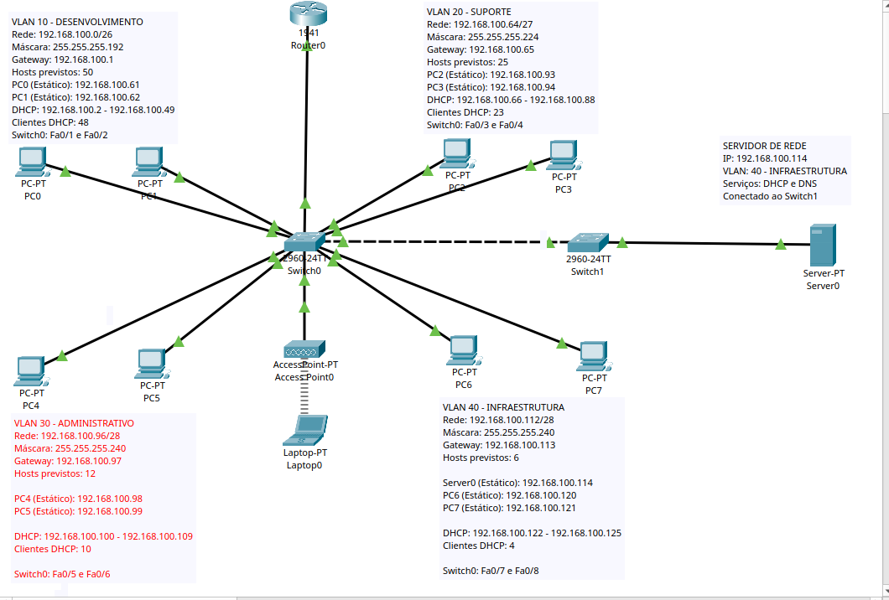
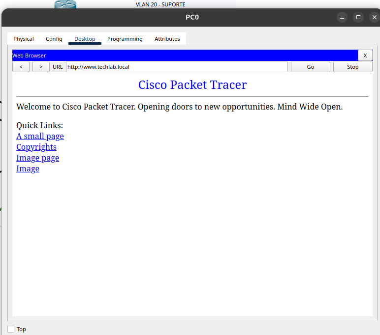
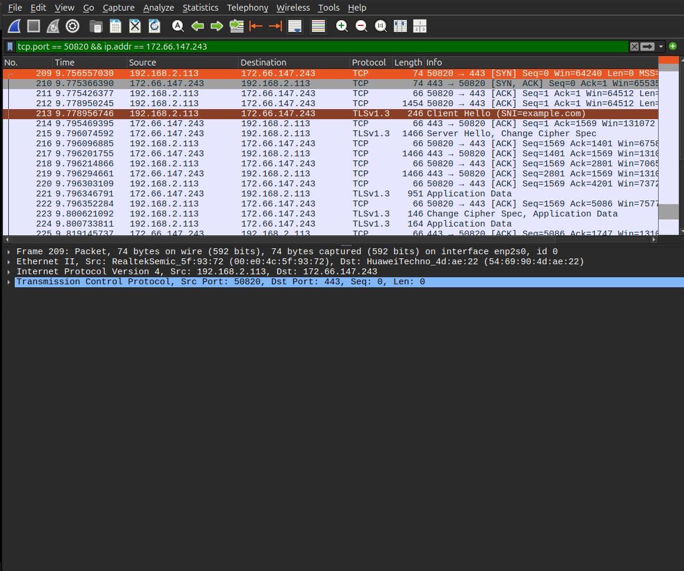

<p align="center">
  
</p>

# TechLab Networks

**Projeto prático de implementação, validação e troubleshooting de uma rede LAN corporativa com Cisco Packet Tracer e Wireshark.**

## Sobre o projeto

O **TechLab Networks** simula a infraestrutura de rede de uma empresa fictícia com quatro departamentos: Desenvolvimento, Suporte, Administrativo e Infraestrutura.

O projeto foi desenvolvido para aplicar conhecimentos de **IPv4, CIDR, VLSM, VLANs, roteamento inter-VLAN, DHCP, DNS, HTTP, SSH, redes wireless e análise de protocolos**.

Após configurar a rede, realizamos testes de conectividade e investigamos cinco situações de falha, registrando evidências e correções.

O objetivo é demonstrar não apenas a configuração dos equipamentos, mas também **por que a comunicação funciona, como os protocolos se relacionam e como investigar problemas de rede**.

## Topologia da rede



A topologia foi construída no **Cisco Packet Tracer** com um roteador, dois switches, oito computadores, um servidor, um Access Point e um notebook wireless.

- **Router0:** realiza o roteamento entre as VLANs por meio de subinterfaces e encapsulamento IEEE 802.1Q.
- **Switch0 e Switch1:** conectam os equipamentos e transportam o tráfego das VLANs por portas de acesso e enlaces trunk.
- **Server0:** disponibiliza DHCP, DNS e HTTP na VLAN 40.
- **Access Point e Laptop0:** demonstram a integração de uma rede sem fio à VLAN 20.

## Planejamento IPv4 e VLANs

Partimos do bloco `192.168.100.0/24` e utilizamos **VLSM** para criar sub-redes de tamanhos adequados às necessidades dos departamentos.

| VLAN | Departamento | Rede / CIDR | Máscara | Gateway |
|---|---|---|---|---|
| 10 | Desenvolvimento | `192.168.100.0/26` | `255.255.255.192` | `192.168.100.1` |
| 20 | Suporte | `192.168.100.64/27` | `255.255.255.224` | `192.168.100.65` |
| 30 | Administrativo | `192.168.100.96/28` | `255.255.255.240` | `192.168.100.97` |
| 40 | Infraestrutura | `192.168.100.112/28` | `255.255.255.240` | `192.168.100.113` |

O **VLSM** organiza o endereçamento IPv4, enquanto as **VLANs** separam logicamente os domínios de broadcast.

Para permitir a comunicação entre os departamentos, configuramos roteamento inter-VLAN no Router0.

## Serviços implementados

| Serviço | Implementação |
|---|---|
| **DHCP** | Distribuição automática de endereços IPv4, máscaras, gateways e DNS para os clientes das VLANs. |
| **DNS** | Registro A de `www.techlab.local` apontando para `192.168.100.114`. |
| **HTTP** | Página web de testes hospedada no Server0. |
| **SSH** | Administração remota do Router0 com autenticação local e comunicação criptografada. |
| **Wireless** | SSID `TECHLAB-WIFI`, associado à VLAN 20, com WPA2-PSK e AES. |

O **Server0** utiliza o endereço estático `192.168.100.114` na VLAN 40.

Para permitir que os clientes das outras VLANs utilizem o serviço DHCP centralizado, configuramos o comando `ip helper-address` nas subinterfaces necessárias do roteador.

## Testes e evidências

Durante o desenvolvimento do projeto, realizamos diferentes testes para validar o funcionamento da infraestrutura.

Entre eles:

- Comunicação entre computadores da mesma VLAN.
- Comunicação entre dispositivos de VLANs diferentes.
- Distribuição automática de endereços IPv4 pelo DHCP.
- Conectividade com o servidor por meio do endereço IP.
- Resolução de nomes utilizando `nslookup`.
- Acesso à página web por HTTP.
- Administração remota utilizando SSH.
- Conexão wireless do notebook à VLAN 20.

### Validação DNS e HTTP



A evidência demonstra o acesso à página web hospedada no Server0 utilizando o endereço `http://www.techlab.local`.

O resultado confirma o funcionamento da resolução DNS e do serviço HTTP durante o teste.

## Análise de tráfego com Wireshark

Em um laboratório separado, utilizando o Ubuntu Linux, realizamos capturas de tráfego com o Wireshark.

Analisamos os seguintes protocolos:

- **DNS:** consultas e respostas de resolução de nomes utilizando UDP.
- **ICMP:** mensagens Echo Request e Echo Reply.
- **TCP:** estabelecimento de conexão por meio do Three-Way Handshake.
- **TLS:** negociação de uma comunicação segura por HTTPS.

### Evidência — TCP Three-Way Handshake



Durante a captura, identificamos as mensagens **SYN, SYN-ACK e ACK**, utilizadas pelo protocolo TCP para estabelecer uma conexão entre cliente e servidor.

O cliente utilizou o endereço `192.168.2.113` e a porta `50820`, enquanto o servidor utilizou o endereço `172.66.147.243` e a porta `443`.

Essa análise permitiu compreender o processo de estabelecimento de uma conexão TCP antes da transmissão dos dados da aplicação.

## Troubleshooting

Após configurar e validar a infraestrutura, simulamos cinco situações de falha para desenvolver habilidades de diagnóstico e resolução de problemas.

| Cenário | Falha investigada | Resultado |
|---|---|---|
| 01 | Máscara de sub-rede incorreta | Inconsistência identificada e corrigida; os pings testados continuaram funcionando. |
| 02 | Gateway incorreto | Comunicação local preservada e falha de acesso a outra VLAN; gateway restaurado. |
| 03 | Porta do switch associada à VLAN incorreta | Falha identificada com `show vlan brief`; associação corrigida. |
| 04 | Subinterface do roteador desativada | Rota conectada ausente; subinterface reativada e comunicação restabelecida. |
| 05 | Servidor DNS incorreto | Acesso por IP funcionando e resolução DNS falhando; configuração corrigida. |

Durante os testes, utilizamos comandos como:

- `ping`
- `ipconfig`
- `tracert`
- `nslookup`
- `show vlan brief`
- `show ip route`

Em todos os cenários, seguimos o processo:

**Sintoma → Estado atual → Evidências → Hipótese → Teste → Correção → Validação**

Essa metodologia permitiu investigar cada falha, compreender sua causa e validar os resultados após as correções.

## Documentação técnica

Todas as etapas do projeto foram organizadas em arquivos Markdown, contendo explicações sobre as configurações realizadas e suas respectivas evidências.

| Parte | Tema | Documentação |
|---|---|---|
| 01 | Planejamento IPv4 e VLSM | [Visualizar](documentacao/01-planejamento-vlsm.md) |
| 02 | Topologia de Rede | [Visualizar](documentacao/02-topologia-rede.md) |
| 03 | Configuração de VLANs | [Visualizar](documentacao/03-configuracao-vlans.md) |
| 04 | Roteamento Inter-VLAN | [Visualizar](documentacao/04-roteamento-inter-vlan.md) |
| 05 | Configuração DHCP | [Visualizar](documentacao/05-configuracao-dhcp.md) |
| 06 | Configuração DNS e HTTP | [Visualizar](documentacao/06-configuracao-dns-http.md) |
| 07 | Acesso Remoto SSH | [Visualizar](documentacao/07-configuracao-ssh.md) |
| 08 | Configuração Wireless | [Visualizar](documentacao/08-configuracao-wireless.md) |
| 09 | Análise com Wireshark | [Visualizar](documentacao/09-analise-wireshark.md) |
| 10 | Troubleshooting | [Visualizar](documentacao/10-troubleshooting.md) |
| 11 | Conclusão e Fluxo de Comunicação | [Visualizar](documentacao/11-documentacao-final.md) |

## Estrutura do repositório

```text
techlab-networks/
|
|-- README.md
|
|-- documentacao/
|   |-- 01-planejamento-vlsm.md
|   |-- 02-topologia-rede.md
|   |-- 03-configuracao-vlans.md
|   |-- 04-roteamento-inter-vlan.md
|   |-- 05-configuracao-dhcp.md
|   |-- 06-configuracao-dns-http.md
|   |-- 07-configuracao-ssh.md
|   |-- 08-configuracao-wireless.md
|   |-- 09-analise-wireshark.md
|   |-- 10-troubleshooting.md
|   |-- 11-documentacao-final.md
|
|-- evidencias/
|   |-- logo-techlab-networks.png
|   |-- evidencia-topologia-01-visao-geral.png
|   |-- demais evidencias das etapas
|
|-- packet-tracer/
    |-- techlab-networks.pkt
```

## Como abrir o laboratório

Para visualizar e explorar a infraestrutura:

1. Instale o **Cisco Packet Tracer**.
2. Acesse a pasta `packet-tracer/` deste repositório.
3. Baixe o arquivo `techlab-networks.pkt`.
4. Abra o arquivo no Cisco Packet Tracer.
5. Explore as configurações dos equipamentos e realize os testes de conectividade.

**[Acessar o projeto no Packet Tracer](packet-tracer/techlab-networks.pkt)**

As capturas e explicações técnicas estão disponíveis nas pastas `evidencias/` e `documentacao/`.

## Tecnologias e ferramentas

- Cisco Packet Tracer
- Cisco IOS CLI
- Wireshark
- Ubuntu Linux
- Git
- GitHub
- IPv4 e CIDR
- VLSM e VLANs
- Ethernet e IEEE 802.1Q
- ARP e ICMP
- TCP e UDP
- DHCP, DNS e HTTP
- SSH e TLS
- WPA2-PSK e AES

## Aprendizados

Durante o desenvolvimento do projeto TechLab Networks, aprendi a organizar uma infraestrutura corporativa utilizando sub-redes IPv4 e VLANs para segmentar os diferentes departamentos.

Também compreendi a importância do roteamento inter-VLAN para permitir a comunicação entre os dispositivos de diferentes redes e o compartilhamento dos serviços disponibilizados pelo servidor.

A implementação do DHCP, DNS, HTTP, SSH e Wireless permitiu aplicar conhecimentos sobre configuração de serviços, acesso remoto e conectividade.

Com o Wireshark, foi possível observar o funcionamento dos protocolos e compreender o processo de encapsulamento dos dados.

Por fim, os cenários de troubleshooting demonstraram a importância de investigar problemas, reunir evidências, formular hipóteses, aplicar correções e validar o funcionamento da rede.

O projeto contribuiu para relacionar os conhecimentos teóricos de redes de computadores com situações práticas de implementação e diagnóstico.

---

**Repositório:** [TechLab Networks no GitHub](https://github.com/mateusvsaraujo2-Slyter/techlab-networks)

