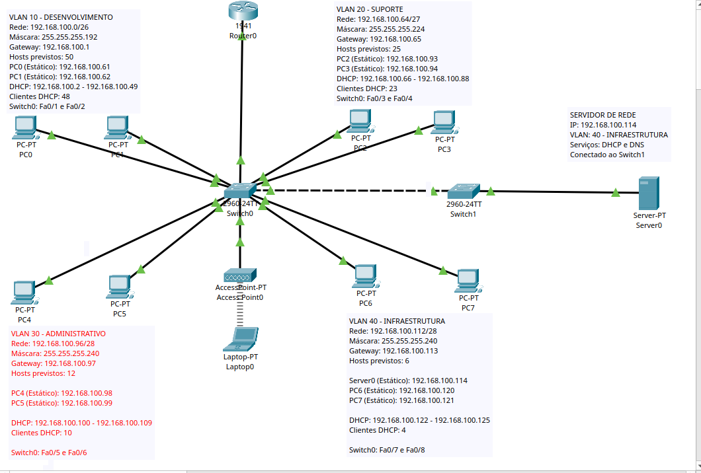

# Topologia de Rede

## Objetivo

O objetivo de construir a topologia no Cisco Packet Tracer foi simular uma rede corporativa organizada por setores, utilizando VLANs para realizar a segmentação lógica dos departamentos e permitir a comunicação entre os dispositivos da infraestrutura.

## Implementação

Primeiramente, organizamos nossa topologia utilizando um roteador, dois switches, oito computadores, um servidor, um Access Point e um notebook wireless.

Utilizamos o roteador para interligar as diferentes VLANs da nossa infraestrutura, permitindo que os dispositivos de departamentos distintos pudessem se comunicar por meio do roteamento inter-VLAN.

Utilizamos os switches para interligar os dispositivos da nossa infraestrutura, permitindo a comunicação entre computadores da mesma VLAN. Também utilizamos esses equipamentos para organizar os dispositivos de acordo com seus respectivos departamentos.

Utilizamos o Server0 para disponibilizar serviços de rede, como DHCP, DNS e HTTP, permitindo que os computadores recebessem endereços IP automaticamente, resolvessem nomes de domínio e acessassem a página web hospedada no servidor.

Por fim, utilizamos um Access Point para permitir que dispositivos wireless, como notebooks, pudessem se conectar à infraestrutura da empresa sem utilizar cabos de rede. Integramos o equipamento à VLAN 20, aproveitando os serviços já disponíveis na rede.

## Evidências

### Evidência 1 — Topologia geral

Topologia completa da TechLab Networks no Cisco Packet Tracer, apresentando a organização dos quatro departamentos, as conexões entre os equipamentos e os dispositivos utilizados na infraestrutura.

