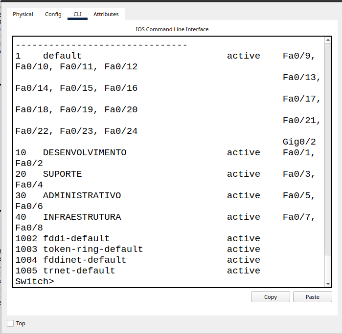
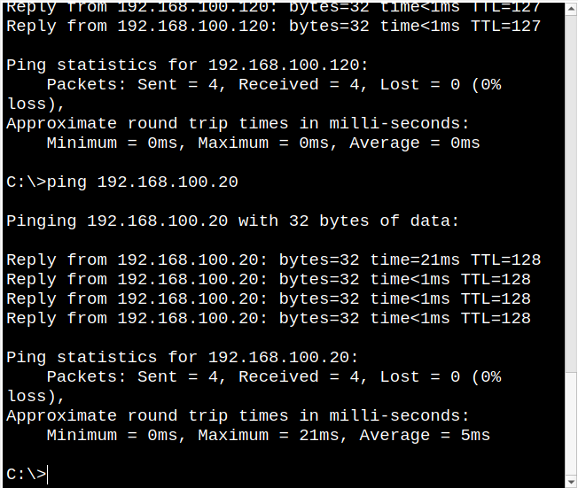

# Configuração de VLANs

## Objetivo

O objetivo de implementar VLANs no projeto Techlab Networks foi separar os departamentos em domínios de broadcast diferentes e melhorar a organização das sub-redes através do controle de tráfego, permitindo a aplicação de controles de segurança entre as redes.

## Implementação 

Para a criação das VLANs, usei o comando `vlan 10`. Em seguida, utilizei o comando `name DESENVOLVIMENTO` para atribuir um nome à VLAN. Esses comandos criaram a VLAN e associaram um nome a ela.

Em seguida, para configurar as portas do switch, utilizei o comando `interface fastEthernet 0/1`, que selecionou a porta Fa0/1 do switch. Depois, usei o comando `switchport mode access`, que configura a porta para transportar o tráfego de uma VLAN.

Por último, utilizei o comando `switchport access vlan 10`, que associa a porta à VLAN 10.

## Evidências 

### Evidência 1 - Configuração das VLANs

O comando `show vlan brief` nos permite verificar se as VLANs foram criadas corretamente e a quais portas do switch elas estão associadas.

### Evidência 2 - Comunicação dentro da VLAN 10

O ping do PC0 para o PC1 permitiu verificar a comunicação entre dois computadores pertencentes à mesma VLAN, com quatro pacotes enviados, quatro recebidos e nenhuma perda.

