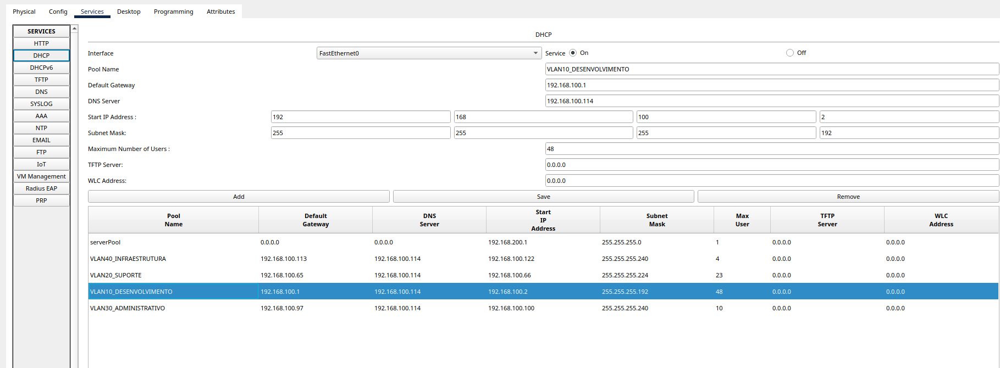
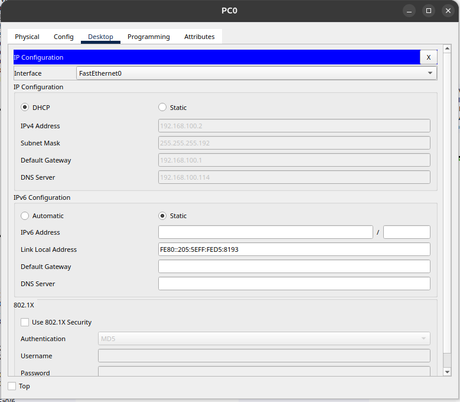

# Configuração DHCP

## Objetivo

Decidi implementar o DHCP no servidor para que ele pudesse distribuir endereços IP automaticamente, de forma dinâmica, aos dispositivos das quatro VLANs.

## Implementação

Primeiro, configuramos um pool para cada VLAN. Em seguida, definimos um intervalo de endereços IP para cada departamento e também configuramos o gateway correspondente a cada rede.

Como o servidor DHCP está conectado diretamente à VLAN 40, foi necessário configurar o comando `ip helper-address` nas subinterfaces das outras VLANs, permitindo que as solicitações DHCP chegassem ao servidor.

Sem o comando `ip helper-address`, os computadores das outras VLANs não conseguiriam receber endereços IP automaticamente, pois os dispositivos enviam mensagens broadcast para solicitar um endereço ao servidor DHCP. Como essas mensagens não atravessam o roteador normalmente, utilizamos o `ip helper-address` para que o roteador receba as solicitações e as encaminhe como unicast ao servidor.

```bash
ip helper-address 192.168.100.114
```

## Evidências

### Evidência 1 — Configuração do servidor DHCP



### Evidência 2 — Validação da distribuição DHCP


