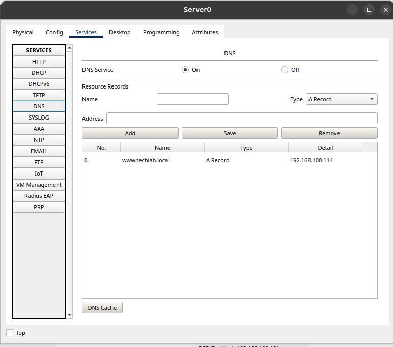
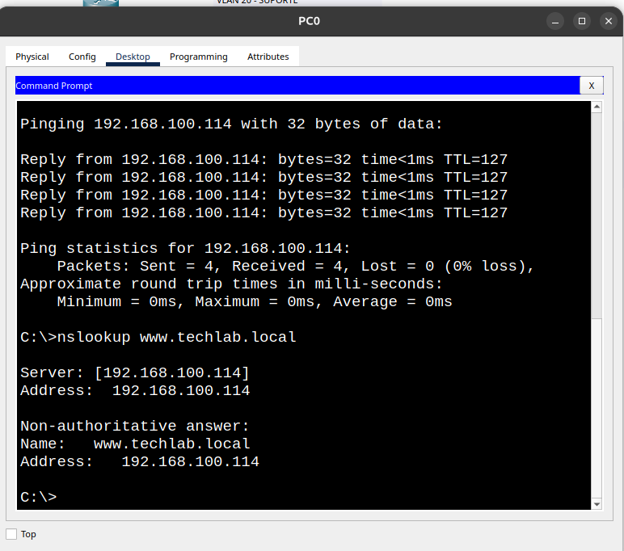

# Configuração DNS e HTTP

## Objetivo

Decidimos implementar os serviços DNS e HTTP no nosso servidor para permitir que os dispositivos acessassem sites pelo nome de domínio. O DNS é responsável por traduzir o nome em um endereço IP, enquanto o HTTP permite acessar o conteúdo disponibilizado pelo site.

## Implementação

Primeiro, ativamos o serviço DNS no servidor. Depois, criamos um registro do tipo A, associando o nome `www.techlab.local` ao endereço IP `192.168.100.114`. Em seguida, ativamos o serviço HTTP para disponibilizar o conteúdo da página web.

## Evidências

### Evidência 1 — Configuração DNS

Registro do tipo A criado no Server0, associando o domínio `www.techlab.local` ao endereço IP `192.168.100.114`.

### Evidência 2 — Testes de conectividade e resolução DNS

Testes realizados no PC0 utilizando os comandos `ping` e `nslookup`, demonstrando a conectividade com o servidor e a resolução correta do domínio.

### Evidência 3 — Acesso HTTP

Acesso à página web do servidor pelo navegador do PC0 utilizando o endereço `http://www.techlab.local`.

