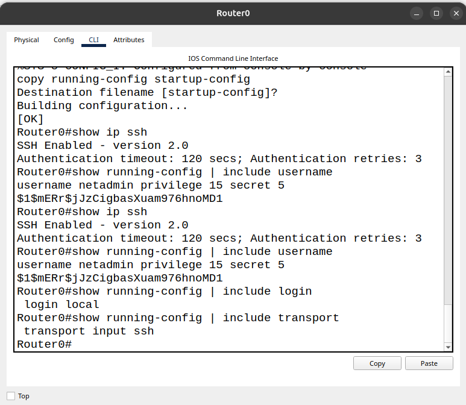
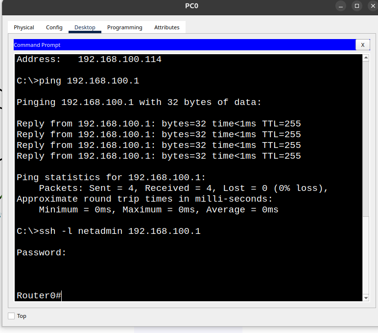

# Configuração SSH

## Objetivo

Decidimos implementar o acesso remoto para permitir que o administrador pudesse acessar e gerenciar o roteador através de outro dispositivo da rede, sem precisar estar fisicamente conectado ao equipamento. Escolhemos o SSH por oferecer maior segurança, pois criptografa a comunicação entre os dispositivos, enquanto o Telnet transmite informações sem criptografia, permitindo que os dados possam ser interceptados.

## Implementação

Primeiro, criamos o usuário `netadmin`. Em seguida, configuramos o domínio `techlab.local` e geramos chaves RSA de 1024 bits. Depois, habilitamos o SSH versão 2, configuramos a autenticação local nas linhas VTY e permitimos somente conexões SSH.

## Evidências

### Evidência 1 — Configuração SSH no roteador

Configuração do SSH versão 2, criação do usuário administrativo e definição da autenticação local, permitindo somente conexões SSH.

### Evidência 2 — Teste de acesso remoto

Conexão SSH realizada pelo PC0 ao Router0, utilizando o usuário `netadmin`, confirmando o acesso remoto ao equipamento.

