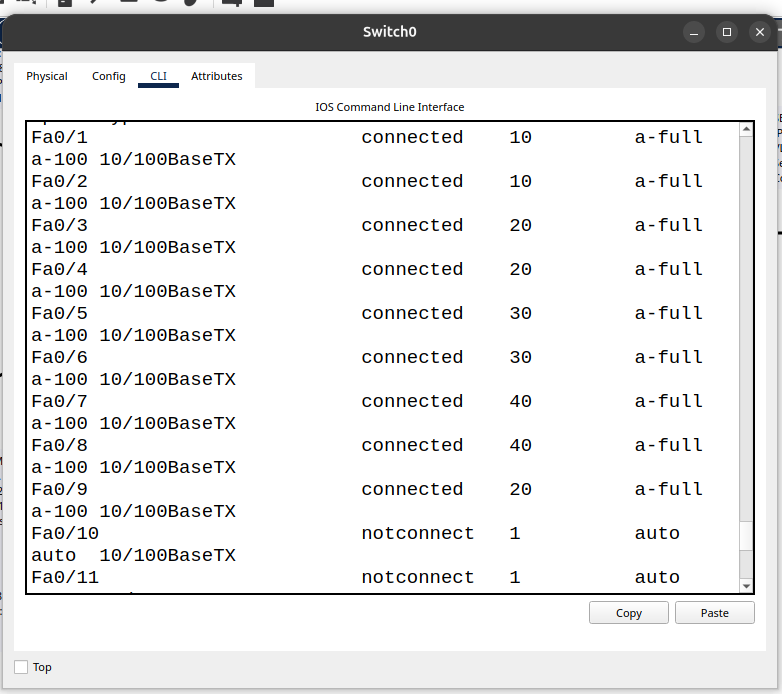
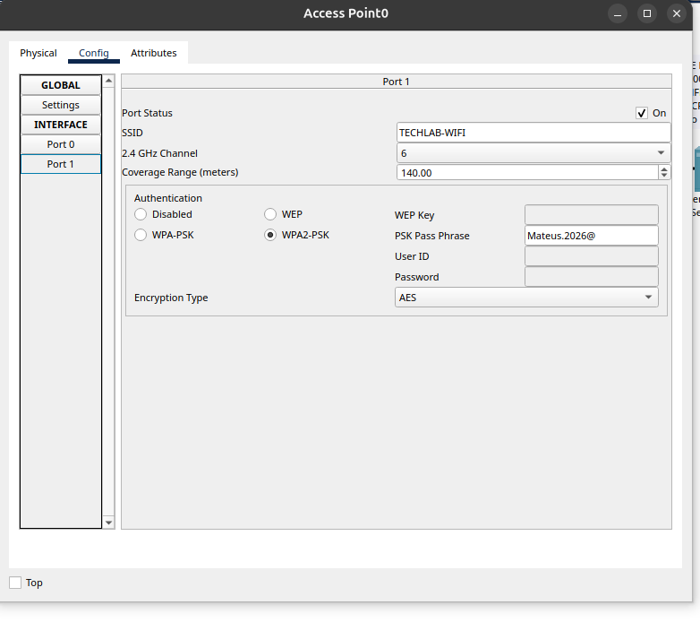
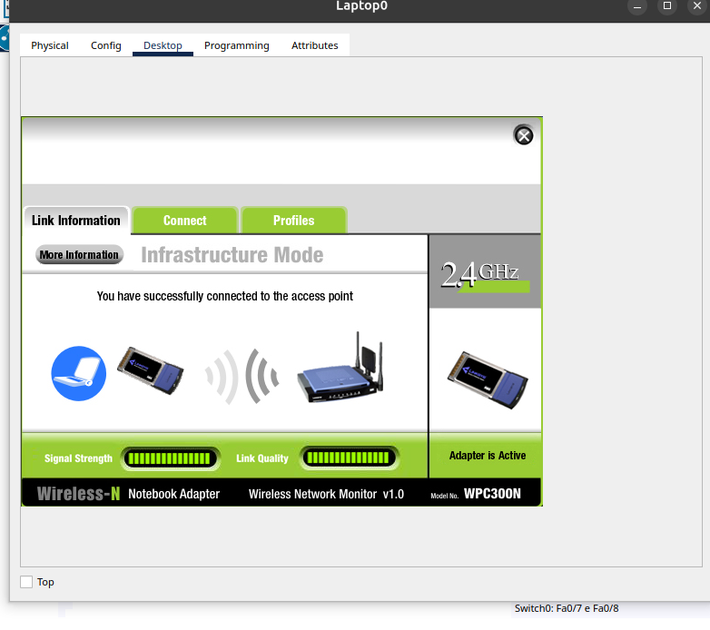
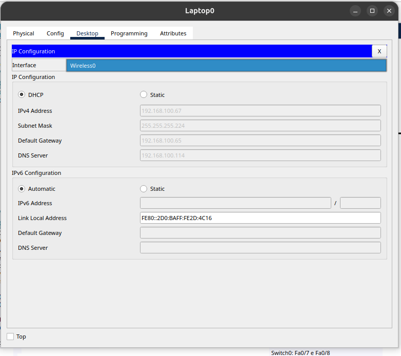
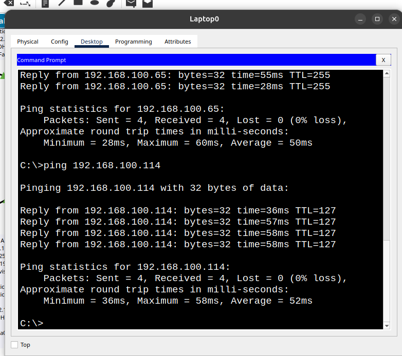
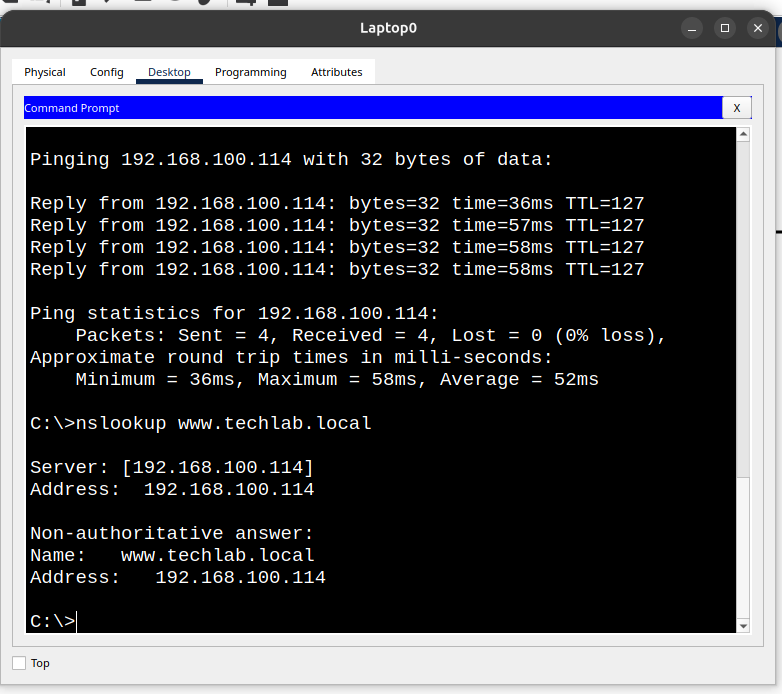
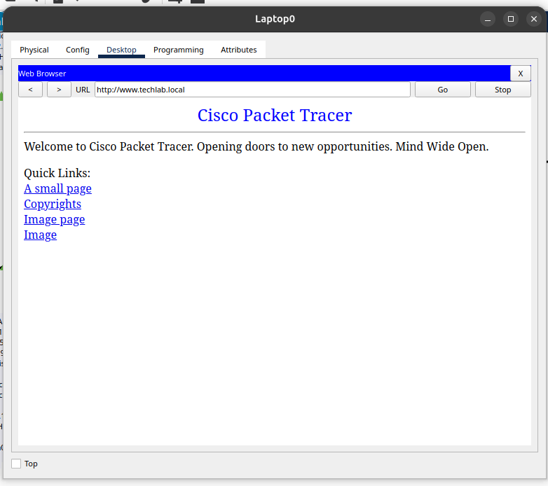

# Configuração Wireless

## Objetivo

O objetivo de implementar uma rede wireless foi expandir a conectividade para dispositivos móveis, como notebooks e celulares, permitindo que os usuários acessassem os recursos da rede em diferentes ambientes da empresa, sem a necessidade de conexões físicas por cabos.

## Implementação

Optamos por integrar a rede wireless à VLAN 20 para aproveitar as configurações e os serviços já existentes na infraestrutura, como o pool DHCP e o servidor DNS. Dessa forma, evitamos a criação de uma nova VLAN e aproveitamos o endereçamento e o roteamento já implementados.

Primeiramente, conectamos o Access Point à interface Fa0/9 do Switch0, configurada para a VLAN 20. Em seguida, configuramos o SSID `TECHLAB-WIFI` para identificar nossa rede wireless e permitir que os dispositivos a encontrassem. Também configuramos a segurança WPA2-PSK com criptografia AES e definimos uma senha para proteger o acesso à rede.

Depois, instalamos uma placa de rede wireless WPC300N no notebook para permitir que ele estabelecesse uma conexão sem fio com o Access Point. Em seguida, configuramos o nome da rede `TECHLAB-WIFI` e sua senha de acesso, utilizando o mesmo padrão de segurança configurado no Access Point.

Utilizamos o DHCP para atribuir automaticamente endereços IPv4 aos novos dispositivos conectados à rede. Como nossa rede wireless está integrada à VLAN 20, que já possui um pool DHCP configurado, conseguimos aproveitar esse serviço sem a necessidade de criar um novo pool de endereços.

Realizamos dois testes de conectividade utilizando o comando `ping`. O primeiro permitiu verificar a comunicação do notebook com o gateway da VLAN 20, enquanto o segundo confirmou a comunicação com o servidor localizado na VLAN 40. Ambos os testes foram realizados com sucesso, sem perda de pacotes.

Utilizamos o comando `nslookup` para verificar se o serviço DNS estava funcionando corretamente e resolvendo nomes de domínio em endereços IP. O teste confirmou que o domínio `www.techlab.local` foi resolvido para o endereço `192.168.100.114`.

Por fim, acessamos o endereço `http://www.techlab.local` pelo navegador do notebook e conseguimos comprovar que o serviço HTTP estava funcionando corretamente, permitindo o acesso à página hospedada no servidor através da rede wireless.

Optamos por utilizar WPA2-PSK com criptografia AES para proteger nossa rede wireless, pois protocolos obsoletos, como WEP, apresentam vulnerabilidades e não oferecem proteção adequada. Por isso, é importante utilizar mecanismos de segurança mais modernos e uma senha forte para evitar acessos não autorizados.

## Evidências

### Evidência 1 — Integração com a VLAN 20

Interface Fa0/9 do Switch0 configurada e conectada à VLAN 20, permitindo a integração do Access Point à rede existente.

### Evidência 2 — Configuração do Access Point

Configuração do SSID `TECHLAB-WIFI`, utilizando WPA2-PSK com criptografia AES para proteger a rede wireless.

### Evidência 3 — Conexão do notebook

Conexão estabelecida entre o notebook e o Access Point, confirmando a associação à rede wireless.

### Evidência 4 — Distribuição DHCP

Notebook recebendo automaticamente o endereço IPv4 `192.168.100.67`, utilizando o pool DHCP da VLAN 20.

### Evidência 5 — Testes de conectividade

Testes de `ping` para o gateway `192.168.100.65` e para o servidor `192.168.100.114`, ambos concluídos sem perda de pacotes.

### Evidência 6 — Resolução DNS

Teste com o comando `nslookup`, confirmando a resolução do domínio `www.techlab.local` para o endereço IPv4 `192.168.100.114`.

### Evidência 7 — Acesso HTTP

Acesso à página hospedada no Server0 pelo navegador do notebook, utilizando o endereço `http://www.techlab.local`.

