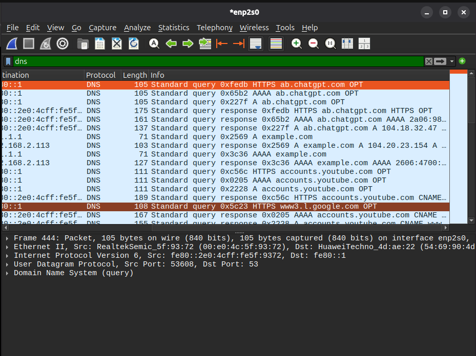
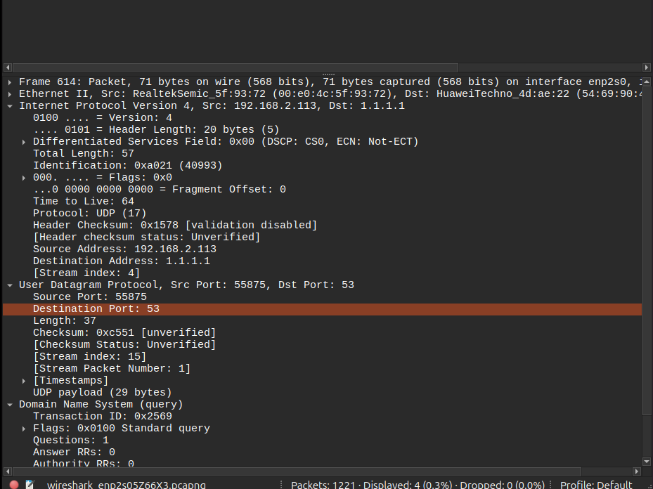
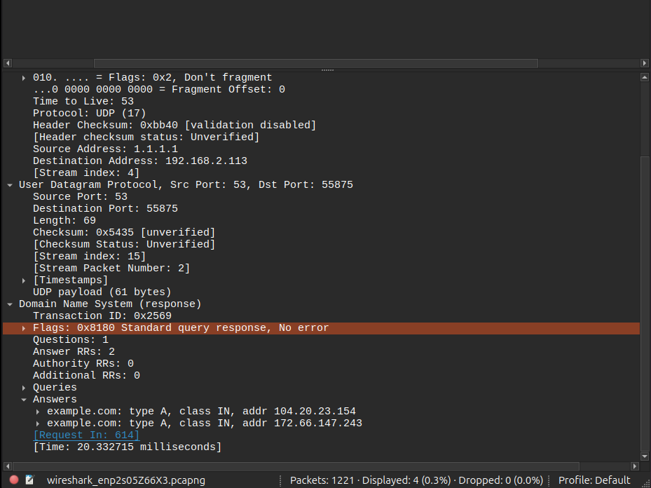
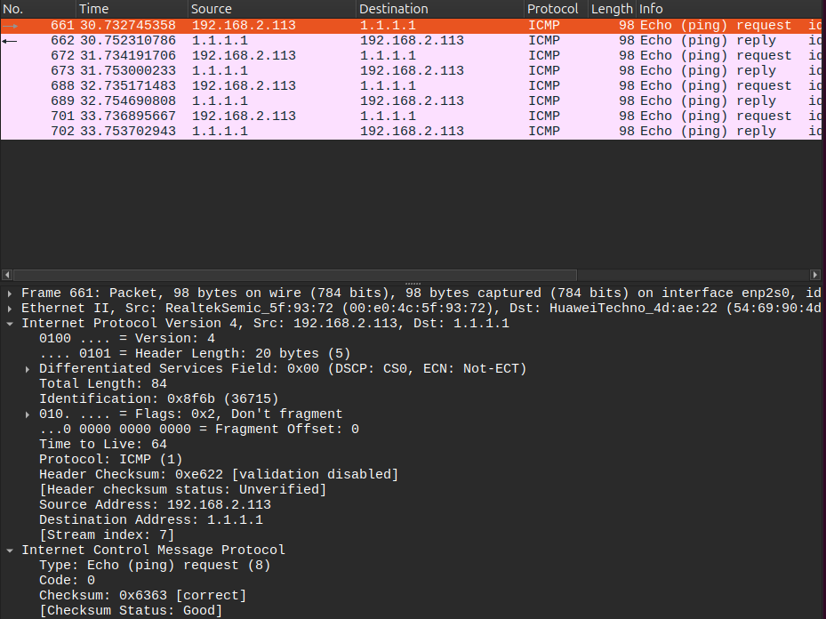
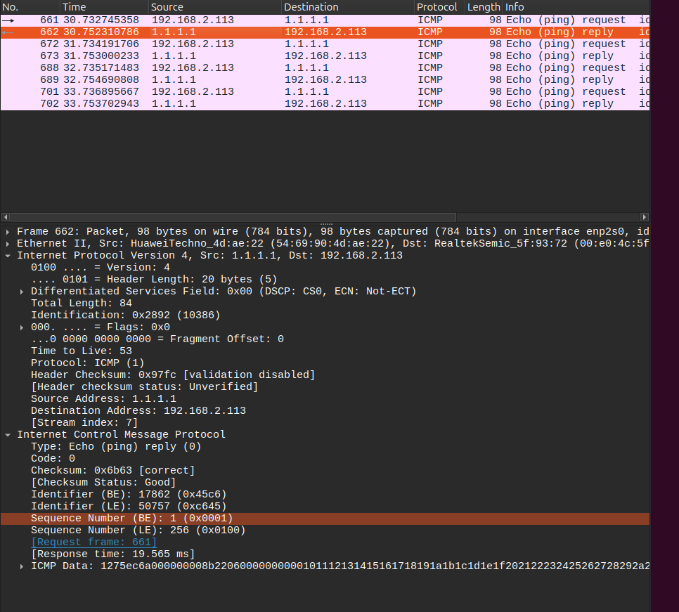
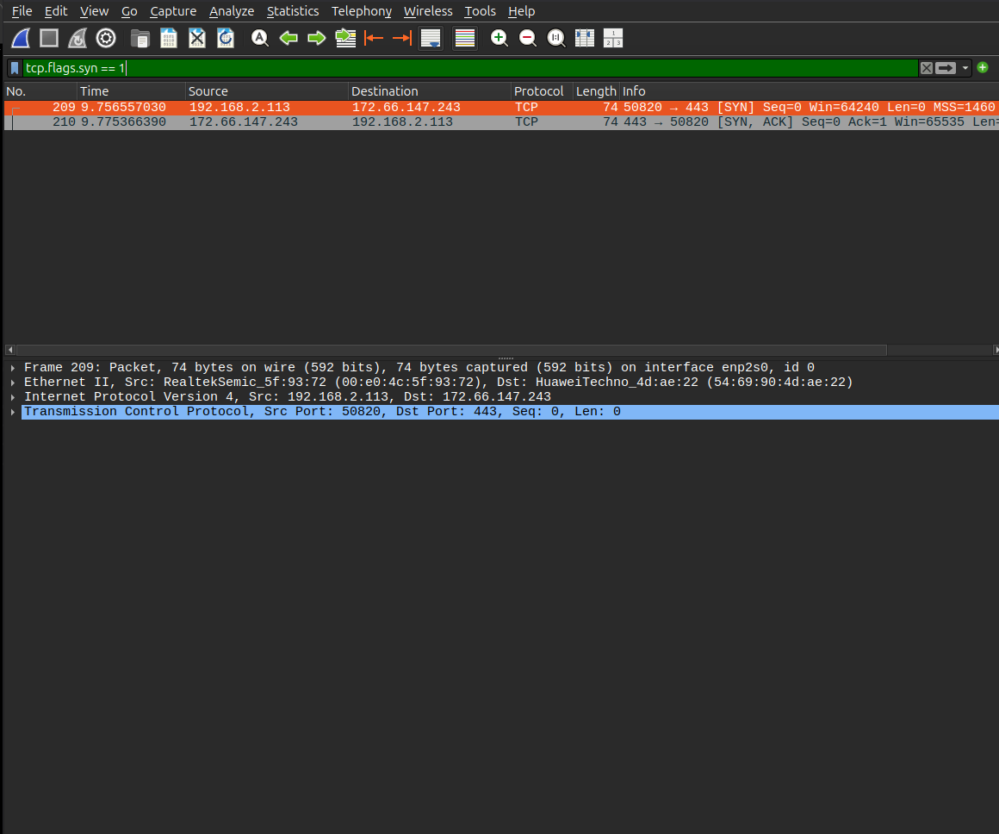
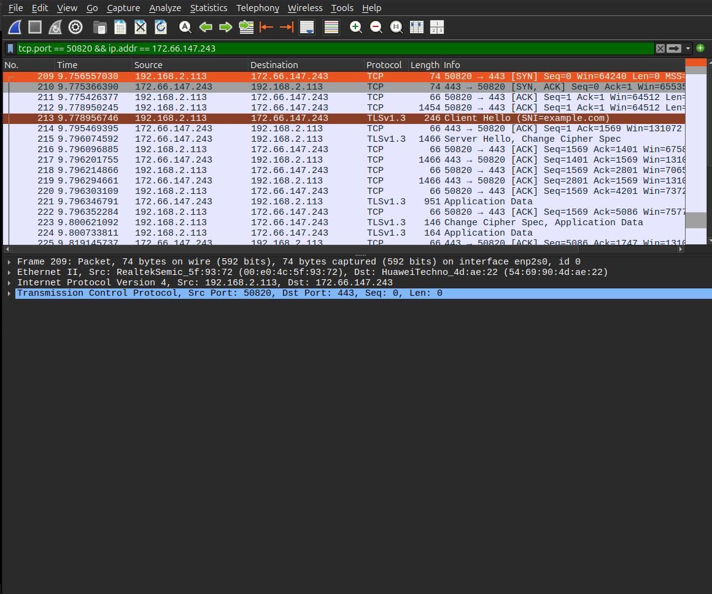
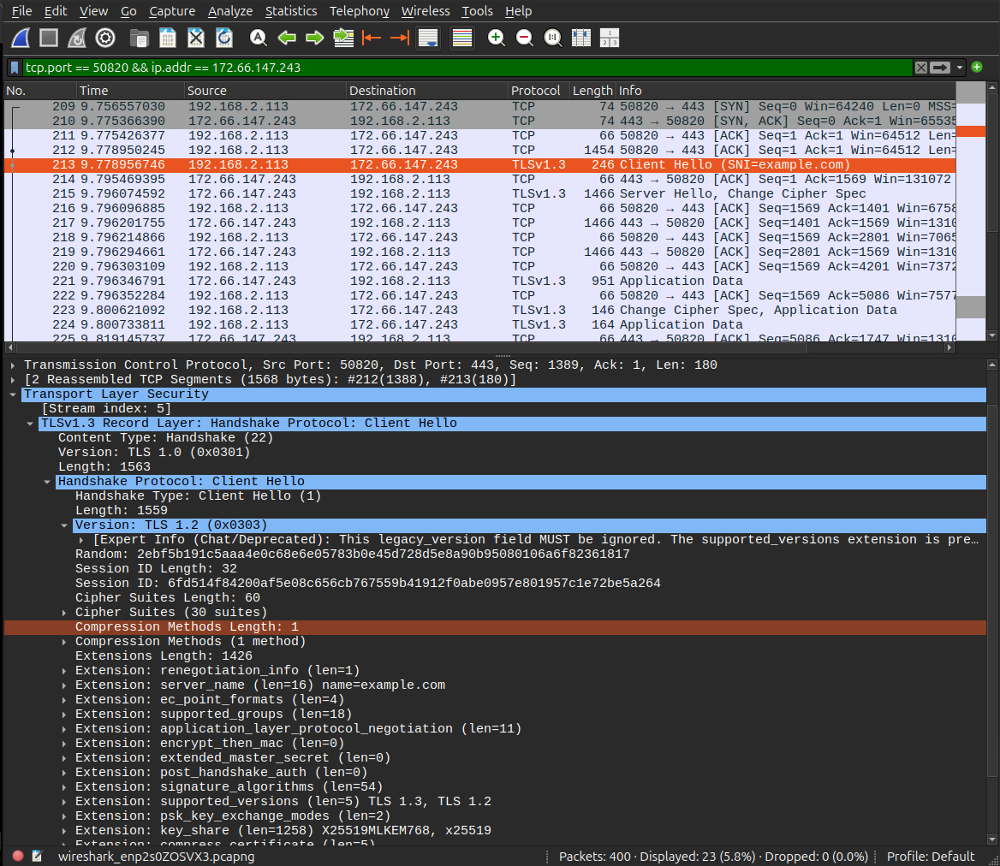

# Análise de Tráfego com Wireshark

## Objetivo

Utilizamos o Wireshark para capturar e analisar o envio e o recebimento de pacotes na rede. Durante as capturas, analisamos protocolos como DNS, ICMP, UDP e TCP. Também observamos o Three-Way Handshake, responsável por estabelecer uma conexão TCP entre o cliente e o servidor.

## Implementação

Primeiramente, iniciamos a captura de tráfego pela interface `enp2s0` no Ubuntu e utilizamos filtros no Wireshark para identificar os protocolos e analisar os pacotes.

Durante a captura **DNS**, observamos a comunicação entre nosso computador e o servidor DNS, que foi responsável por traduzir o nome de domínio `example.com` em endereços IP. Também identificamos que a consulta utilizou o protocolo UDP e a porta `53`. O computador `192.168.2.113` enviou a consulta pela porta `55875` ao servidor `1.1.1.1`, que respondeu com os endereços IPv4 `104.20.23.154` e `172.66.147.243`. O identificador `0x2569` permitiu relacionar a consulta à resposta.

Durante a captura dos pacotes **ICMP**, observamos as mensagens de ping enviadas pelo nosso computador ao endereço `1.1.1.1`. Identificamos as mensagens *Echo Request* (`Type 8`), responsáveis pela solicitação, e *Echo Reply* (`Type 0`), que representam as respostas recebidas, permitindo verificar a comunicação entre os dispositivos. Para gerar o tráfego, utilizamos `ping -c 4 1.1.1.1`. O ICMP não utiliza portas TCP ou UDP.

Durante a captura do **Three-Way Handshake**, observamos o estabelecimento da conexão TCP entre nosso computador `192.168.2.113:50820` e o servidor `172.66.147.243:443`, por meio das mensagens `SYN`, `SYN-ACK` e `ACK`. Esse processo permite que os dois dispositivos estabeleçam uma conexão antes de iniciar a troca de dados da aplicação.

Por fim, durante a análise **HTTPS/TLS**, observamos a negociação TLS entre nosso computador e o servidor. A finalidade desse protocolo é estabelecer uma comunicação segura, utilizando criptografia para proteger os dados transmitidos durante o acesso à aplicação web. Identificamos as mensagens *Client Hello* e *Server Hello*, além de registros *Application Data*. No *Client Hello*, observamos o domínio `example.com` na extensão SNI e o suporte a TLS 1.3 e TLS 1.2.

Também analisamos os endereços MAC no cabeçalho **Ethernet II**. Na consulta DNS enviada, o MAC de origem foi `00:e0:4c:5f:93:72` (computador) e o MAC de destino foi `54:69:90:4d:ae:22` (próximo salto na rede local). Como o servidor DNS estava fora da rede local, o MAC de destino do quadro não era o MAC do servidor remoto.

Essas capturas nos permitiram observar o **encapsulamento** dos protocolos: DNS sobre UDP, IPv4 e Ethernet; ICMP diretamente sobre IPv4 e Ethernet; e HTTPS utilizando TLS sobre TCP, IPv4 e Ethernet. Assim, verificamos como diferentes protocolos participam da mesma comunicação.

## Evidências

### Evidência 1 — Consultas e respostas DNS

Pacotes de consulta e resposta DNS encontrados no Wireshark, incluindo o domínio `example.com`.

### Evidência 2 — Consulta DNS: IPv4 e UDP

Consulta enviada de `192.168.2.113:55875` para `1.1.1.1:53`, permitindo observar os endereços IP e as portas UDP.

### Evidência 3 — Resposta DNS

Resposta do servidor `1.1.1.1`, com o identificador `0x2569` e os endereços IPv4 retornados para `example.com`.

### Evidência 4 — ICMP Echo Request

Solicitação de ping de `192.168.2.113` para `1.1.1.1`, identificada pelo campo `Type 8`.

### Evidência 5 — ICMP Echo Reply

Resposta do destino `1.1.1.1` para nosso computador, identificada pelo campo `Type 0`.

### Evidência 6 — TCP SYN e SYN-ACK

Primeiras duas mensagens do estabelecimento da conexão TCP entre o computador e o servidor na porta `443`.

### Evidência 7 — TCP Three-Way Handshake

Sequência completa `SYN`, `SYN-ACK` e `ACK`, confirmando o estabelecimento da conexão TCP.

### Evidência 8 — TLS Client Hello

Início da negociação TLS, mostrando a mensagem *Client Hello*, o domínio `example.com` e as versões TLS suportadas pelo cliente.

