# Troubleshooting de Rede

## Objetivo

O objetivo de realizar o troubleshooting foi simular diferentes falhas na infraestrutura do projeto TechLab Networks, para que pudéssemos investigar suas causas, identificar os problemas e aplicar as correções necessárias para restabelecer o funcionamento da rede.

## Implementação

### Cenário 01 — Máscara de sub-rede incorreta

Primeiramente, alteramos a máscara de sub-rede do PC2, pertencente à VLAN 20, para simular uma configuração incorreta. Identificamos o erro utilizando o comando `ipconfig` e realizamos testes de conectividade com `ping` e `tracert`. Mesmo com os testes funcionando, foi necessário restaurar a máscara correta para manter o endereçamento de acordo com o planejamento da rede.

- **Sintoma:** configuração IPv4 incompatível com a VLAN 20, sem perda de conectividade observada.
- **Estado atual:** PC2 com IP `192.168.100.93`, máscara incorreta `255.255.255.240` (/28) e gateway `192.168.100.65`.
- **Evidências:** saída do `ipconfig`, testes de `ping` e `tracert`.
- **Hipótese:** máscara de sub-rede diferente da definida no planejamento VLSM.
- **Teste:** conferência dos parâmetros IPv4 e da comunicação com o PC3, o gateway e o servidor.
- **Correção:** restauração da máscara `255.255.255.224` (/27).
- **Validação:** configuração novamente compatível com a rede `192.168.100.64/27`. A máscara errada foi diagnosticada, mas não produziu perda de pacotes nos testes realizados.

### Cenário 02 — Gateway incorreto

Em seguida, alteramos o gateway do PC2 para simular uma falha de comunicação. Durante os testes, observamos que o PC2 continuava conseguindo se comunicar com o PC3, pois ambos pertencem à mesma sub-rede e não precisam utilizar o gateway para trocar pacotes. Entretanto, a comunicação com o servidor da VLAN 40 falhou, pois os dispositivos pertencem a redes diferentes e precisam de um gateway válido para realizar o roteamento. Após restaurarmos o gateway correto, a comunicação voltou a funcionar.

- **Sintoma:** comunicação local funcionando, mas acesso ao servidor de outra VLAN indisponível.
- **Estado atual:** gateway do PC2 alterado de `192.168.100.65` para `192.168.100.92`.
- **Evidências:** ping para o PC3 com sucesso e ping para o servidor com 100% de perda.
- **Hipótese:** gateway configurado incorretamente.
- **Teste:** `ping 192.168.100.94` e `ping 192.168.100.114`.
- **Correção:** restauração do gateway `192.168.100.65`.
- **Validação:** comunicação com o servidor restabelecida, com 0% de perda de pacotes.

### Cenário 03 — VLAN incorreta

Durante o terceiro teste, alteramos a interface `Fa0/3` do Switch0, transferindo o PC2 da VLAN 20 para a VLAN 30. Com isso, o PC2 perdeu a comunicação com o PC3, pois os dispositivos passaram a pertencer a redes lógicas diferentes. Identificamos a configuração incorreta utilizando o comando `show vlan brief` e restauramos a interface para a VLAN 20, restabelecendo a comunicação.

- **Sintoma:** perda de comunicação entre PC2 e PC3.
- **Estado atual:** interface `Fa0/3` do Switch0 configurada na VLAN 30, embora o PC2 utilize o endereçamento da VLAN 20.
- **Evidências:** saída de `show vlan brief` e ping com 100% de perda.
- **Hipótese:** porta de acesso associada à VLAN errada.
- **Teste:** verificação da VLAN da interface e `ping 192.168.100.94`.
- **Correção:** comando `switchport access vlan 20` na interface `Fa0/3`.
- **Validação:** porta novamente na VLAN 20 e pings para o PC3 e o gateway com 0% de perda.

### Cenário 04 — Falha de roteamento

Durante o quarto teste, desativamos a subinterface `G0/0.40` do roteador para simular uma falha de roteamento. Observamos que o PC2 continuava conseguindo acessar seu gateway, pois a subinterface da VLAN 20 permanecia ativa. Entretanto, perdeu a comunicação com o servidor da VLAN 40, porque a subinterface responsável por essa rede estava desativada. Identificamos a ausência da rota utilizando o comando `show ip route` e restauramos a comunicação com o comando `no shutdown`.

- **Sintoma:** gateway da VLAN 20 acessível, mas servidor da VLAN 40 inacessível.
- **Estado atual:** subinterface `G0/0.40` desativada e rota conectada `192.168.100.112/28` ausente.
- **Evidências:** tabela de roteamento sem a rede da VLAN 40 e ping para o servidor com falha.
- **Hipótese:** ausência de rota em consequência da desativação da subinterface.
- **Teste:** `show ip route`, `ping 192.168.100.65` e `ping 192.168.100.114`.
- **Correção:** comando `no shutdown` na subinterface `G0/0.40`.
- **Validação:** rota conectada restaurada e, na validação final, ping para o servidor com 0% de perda.

### Cenário 05 — DNS incorreto

Por fim, alteramos o endereço do servidor DNS configurado no PC2 para simular uma falha na resolução de nomes. O computador continuou conseguindo se comunicar com o servidor pelo endereço IP, mas não conseguiu resolver o domínio `www.techlab.local`, pois a configuração DNS estava incorreta. Após restaurarmos o endereço do servidor DNS, a resolução de nomes voltou a funcionar.

- **Sintoma:** acesso ao servidor por IP funcionando, mas consulta DNS apresentando timeout.
- **Estado atual:** DNS do PC2 alterado de `192.168.100.114` para `192.168.100.115`.
- **Evidências:** ping com sucesso e consulta `nslookup` sem resposta válida.
- **Hipótese:** endereço incorreto do servidor DNS.
- **Teste:** `ping 192.168.100.114` e `nslookup www.techlab.local`.
- **Correção:** restauração do servidor DNS `192.168.100.114`.
- **Validação:** domínio `www.techlab.local` resolvido para `192.168.100.114`.

## Evidências

### Cenário 01 — Máscara incorreta

Máscara IPv4 incorreta identificada no PC2.

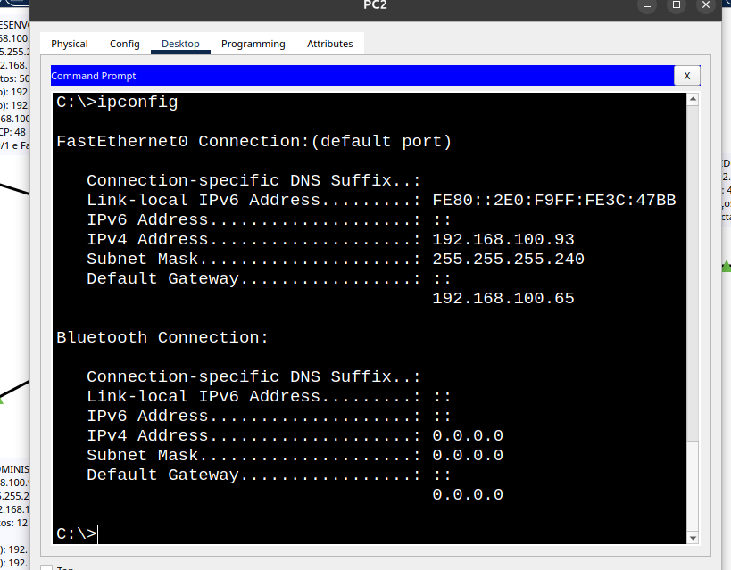

Testes de conectividade e rastreamento da rota, demonstrando que não houve interrupção de comunicação nesse cenário.

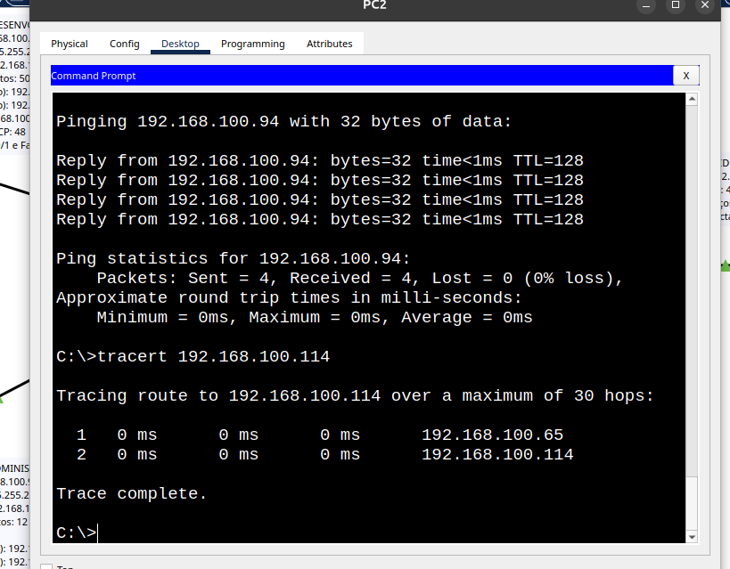

### Cenário 02 — Gateway incorreto

Falha na comunicação com o servidor após configurar o gateway incorreto.

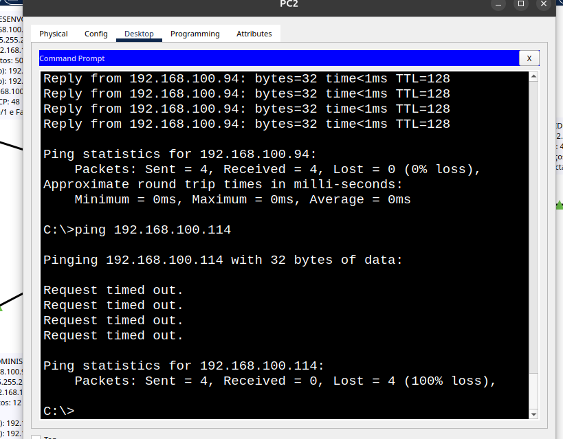

Comunicação restabelecida após corrigir o gateway.

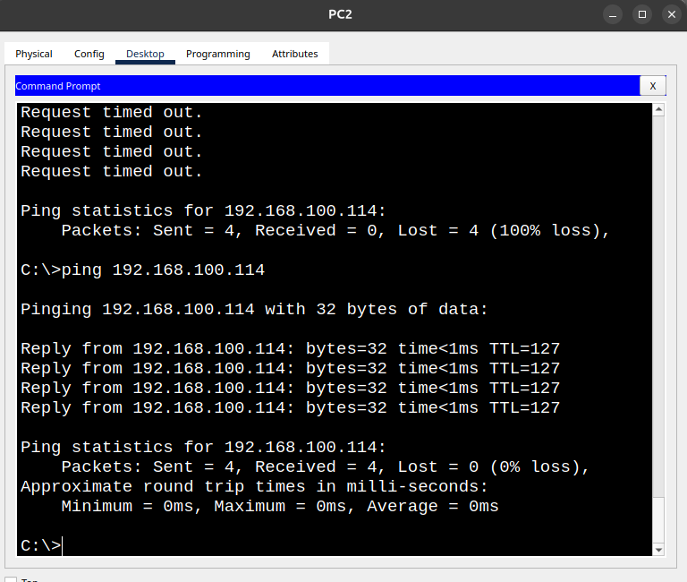

### Cenário 03 — VLAN incorreta

Interface `Fa0/3` associada à VLAN 30 indevidamente.

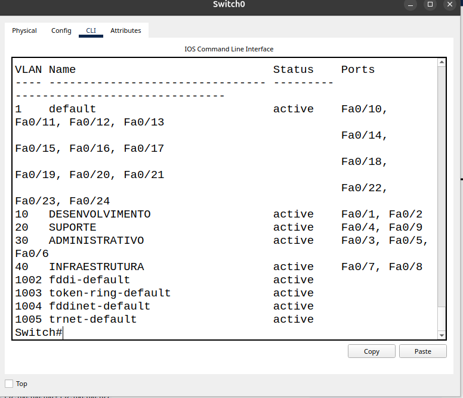

Falha na comunicação do PC2 com o PC3.

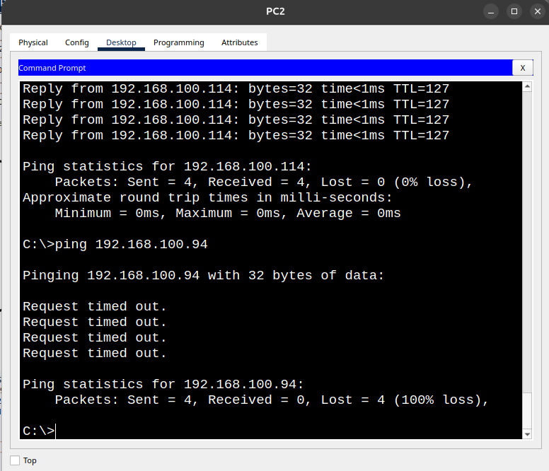

Porta restaurada para a VLAN 20.

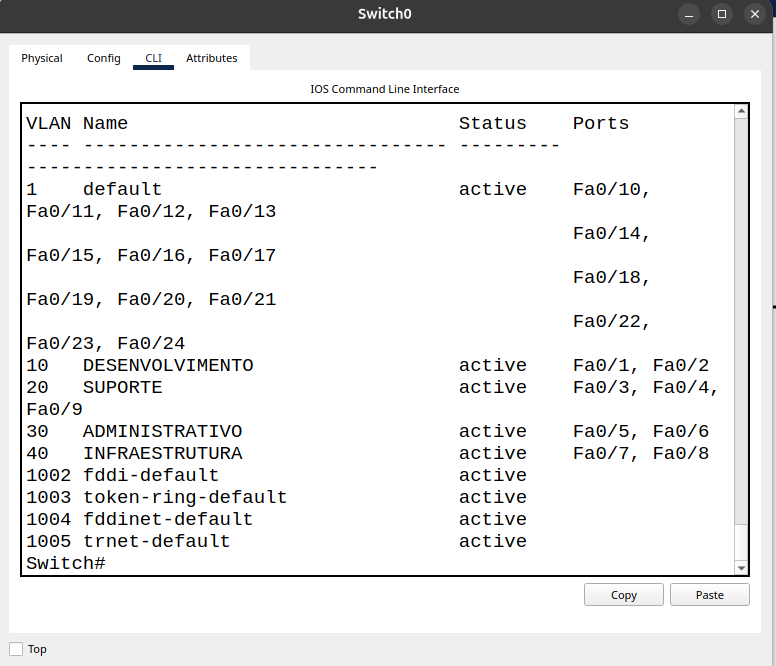

Comunicação validada após a correção.

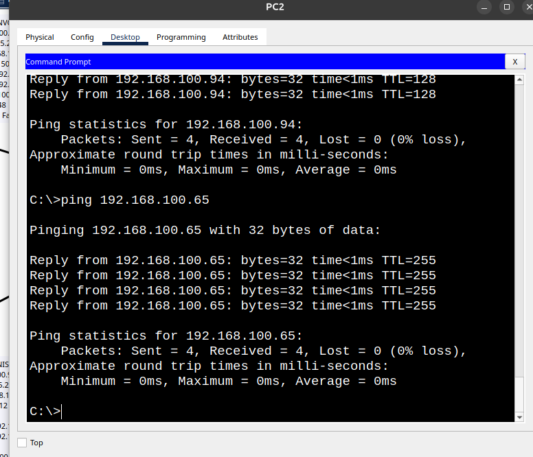

### Cenário 04 — Falha de roteamento

Ausência da rota conectada da VLAN 40 na tabela de roteamento.

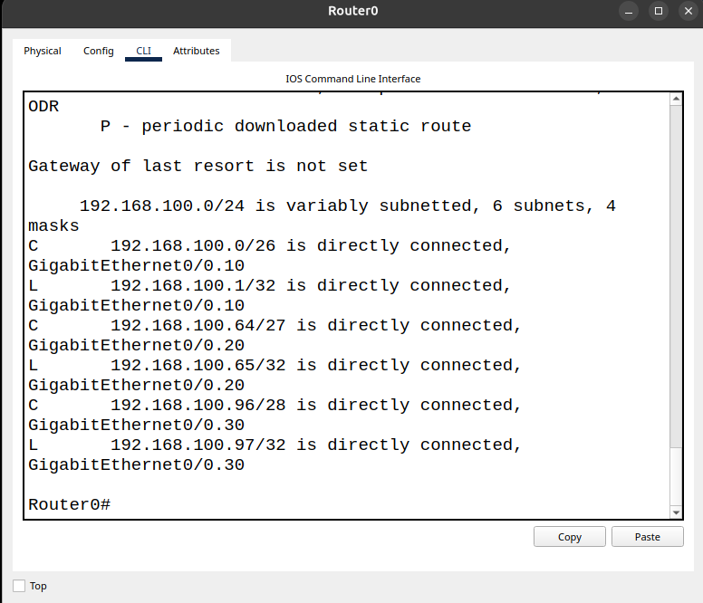

Falha de comunicação com o servidor.

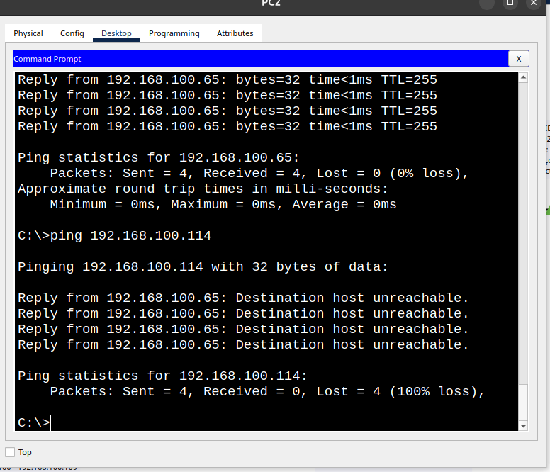

Rota da VLAN 40 restaurada após ativar a subinterface.

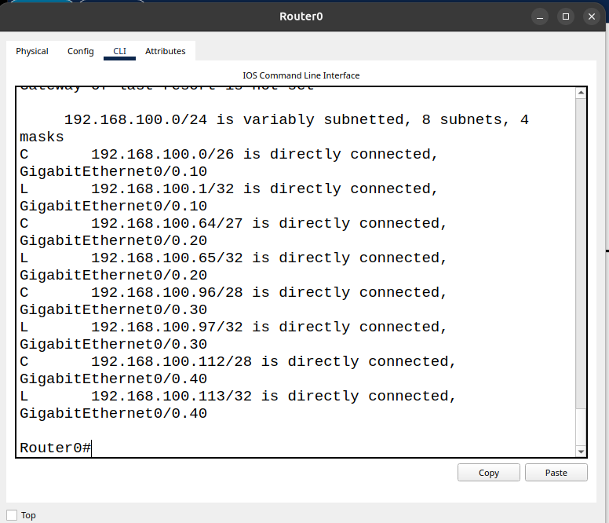

Ping final com o servidor funcionando novamente.

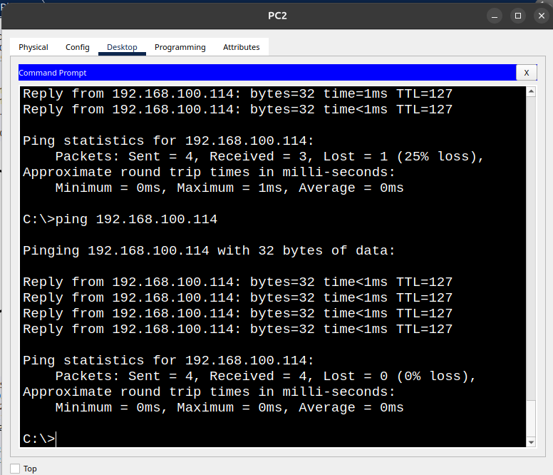

### Cenário 05 — DNS incorreto

Falha na resolução de nomes com DNS configurado incorretamente.

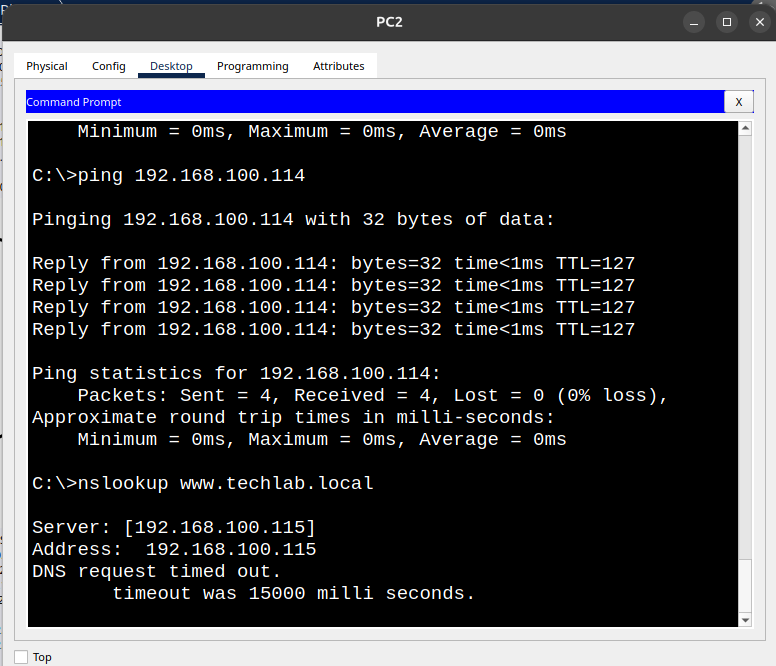

Consulta DNS funcionando após restaurar o endereço correto.

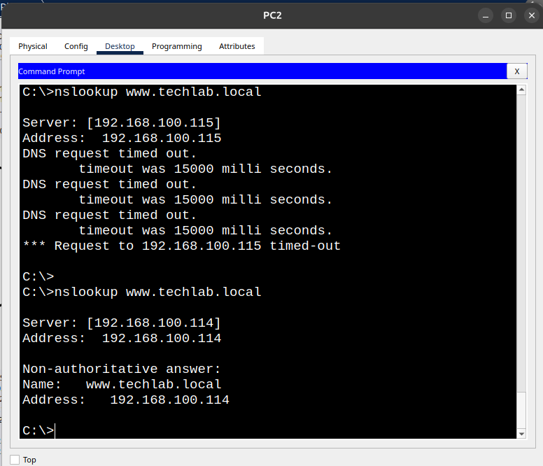

