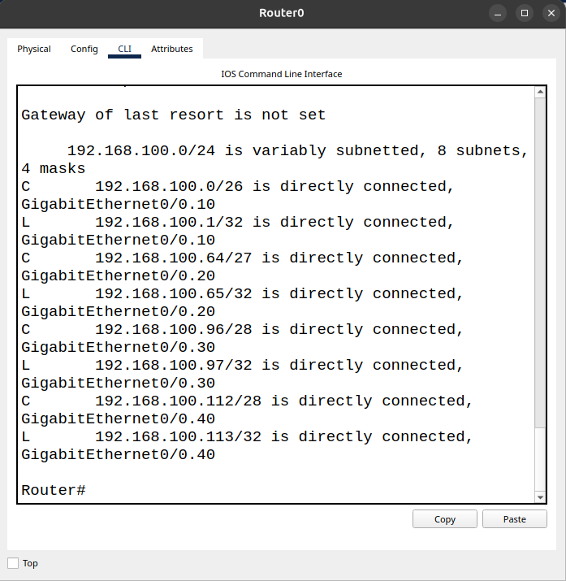
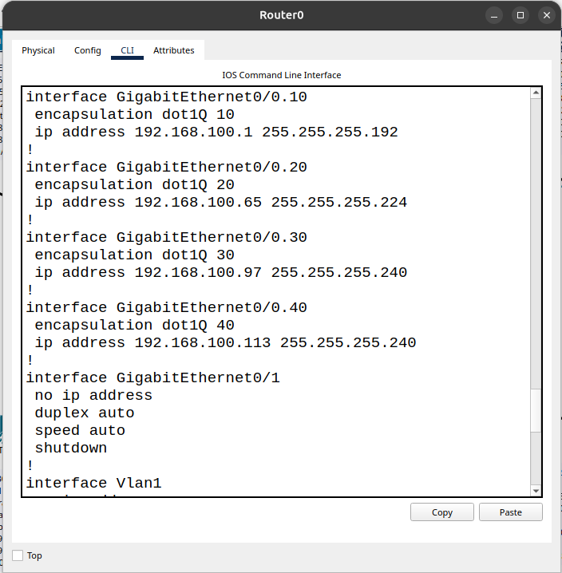

# Planejamento de Endereçamento IPv4 - VLSM

 O Objetivo de utilizar VLSM no projeto TechLab Networks foi fazer a divisão do bloco de endereços IPv4 da rede 192.168.100.0/24 em 4 sub-redes cada uma configurada de acordo com a necessidade e a quantidade de hosts. Essa organização nos permite otimizar o uso de endereços IPv4 evitando assim desperdícios de endereços 

## Tabela de Endereçamento VLSM

| VLAN | Departamento | Hosts necessários | Rede/CIDR | Máscara |
|------|--------------|-------------------|-----------|---------|
| 10 | Desenvolvimento | 50 | 192.168.100.0/26 | 255.255.255.192 |
| 20 | Suporte | 25 | 192.168.100.64/27 | 255.255.255.224 |
| 30 | Administrativo | 12 | 192.168.100.96/28 | 255.255.255.240 |
| 40 | Infraestrutura | 6 | 192.168.100.112/28 | 255.255.255.240 |

## Intervalos de Endereços IPv4

| VLAN | Primeiro host | Último host | Broadcast | Gateway |
|------|---------------|-------------|-----------|---------|
| 10 | 192.168.100.1 | 192.168.100.62 | 192.168.100.63 | 192.168.100.1 |
| 20 | 192.168.100.65 | 192.168.100.94 | 192.168.100.95 | 192.168.100.65 |
| 30 | 192.168.100.97 | 192.168.100.110 | 192.168.100.111 | 192.168.100.97 |
| 40 | 192.168.100.113 | 192.168.100.126 | 192.168.100.127 | 192.168.100.113 |

## Cálculo dos Prefixos CIDR

| VLAN | Prefixo CIDR | Bits para hosts | Cálculo | Hosts utilizáveis |
|------|--------------|-----------------|---------|-------------------|
| 10 | /26 | 6 | 2^6 - 2 = 62 | 62 |
| 20 | /27 | 5 | 2^5 - 2 = 30 | 30 |
| 30 | /28 | 4 | 2^4 - 2 = 14 | 14 |
| 40 | /28 | 4 | 2^4 - 2 = 14 | 14 

## Evidências

A tabela de roteamento demonstra que cada sub-rede está diretamente conectada ao roteador por sua respectiva subinterface. Podemos observar também os endereços de rede e seus respectivos prefixos CIDR.

### Evidência 1 - Sub-redes configuradas no roteador 

A segunda evidência mostra a configuração das quatro subinterfaces do roteador. Essas subinterfaces permitem ao roteador identificar o tráfego de várias VLANs por uma única interface física.

Também podemos observar o encapsulamento IEEE 802.1Q, que permite identificar a qual VLAN pertence cada quadro Ethernet. Como as VLANs compartilham um único cabo para transmitir informações, essa identificação permite ao roteador distinguir o tráfego de cada rede.
### Evidencia 2 - Configuração dos gateways e máscaras

