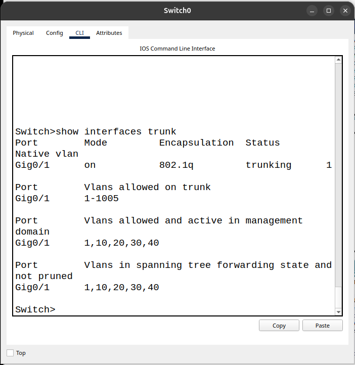
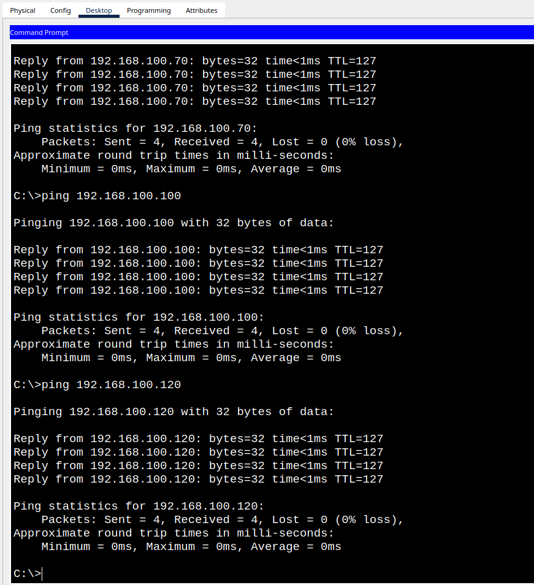

# Roteamento Inter-VLAN

## Objetivo

Foi necessário configurar o roteamento inter-VLAN para que as sub-redes pudessem se comunicar entre si.

## Implementação

### Configuração do trunk

```bash
interface gigabitEthernet 0/1
switchport mode trunk
```

A função da porta Trunk foi permitir a conexão das quatro redes ao roteador utilizando apenas um cabo físico.

### Configuração das subinterfaces 

```bash
interface gigabitEthernet 0/0.10
encapsulation dot1Q 10
ip address 192.168.100.1 255.255.255.192
exit

interface gigabitEthernet 0/0.20
encapsulation dot1Q 20
ip address 192.168.100.65 255.255.255.224
exit

interface gigabitEthernet 0/0.30
encapsulation dot1Q 30
ip address 192.168.100.97 255.255.255.240
exit

interface gigabitEthernet 0/0.40
encapsulation dot1Q 40
ip address 192.168.100.113 255.255.255.240
exit
```

O comando `encapsulation dot1Q` permite identificar o tráfego de cada VLAN, utilizando uma etiqueta (tag) para diferenciar os quadros Ethernet que passam pelo mesmo cabo.

Também configuramos um endereço IPv4 diferente em cada subinterface do roteador, para que cada sub-rede tenha seu próprio gateway e possa se comunicar com outras redes.


## Evidências

### Evidência 1 — Validação do Trunk

O comando `show interfaces trunk` demonstra que a porta Gi0/1 está preparada para transportar o tráfego das quatro VLANs pelo mesmo cabo físico.




### Evidência 2 — Comunicação inter-VLAN

Os três testes de ping mostram que a comunicação entre as redes está acontecendo normalmenteo.
Os testes apresentaram 0% de perda de pacotes, validando a comunicação da VLAN 20,30,40


